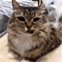

<p align="center">
  
</p>

# rbxyoinker

Roblox asset downloader that runs locally. Start the exe, it opens in your browser,
paste an asset id or link, and it saves the file. Everything goes straight from your
machine to Roblox, there's no server in between.

Works with audio, images, decals, meshes, models, animations and pretty much anything
else that has an asset id.

## Installation

Download `rbxyoinker.exe` from [releases](https://github.com/3vil17/rbxyoinker/releases) and run it.
Windows only for now.

Or build it (Rust + MSVC build tools):

```
cargo build --release
```

The exe ends up in `target/release/rbxyoinker.exe`.

## Usage

When you run it, a browser tab opens. If it doesn't, go to http://127.0.0.1:48620.
Running the exe again while it's already open just brings the tab back. There's no
window, to close it use **Quit** at the bottom of the page.

- **Download** - paste an id or any roblox.com / create.roblox.com link and hit Fetch.
  You get a preview with the type, whether it's public or private, and a Play button
  for audio. Put a number in Version to grab an older version of the asset.
- **Bulk** - paste up to 1000 ids or links, or drop a `.rbxl` / `.rbxm` / `.rbxlx` /
  `.rbxmx` file on it to pull every asset id out of a place or model. Filter by type
  and by public / private before you start. Afterwards you can retry the failed ones,
  copy their ids or zip everything.
- **Migrate** - move a place's assets to your account or a group, from Studio. See below.
- **Accounts** - every cookie you added, with its avatar, whether it still works and
  how many requests it has done.
- **Settings** - API key, cookies, download folder, sorting into folders per type, and
  saving meshes as `.obj` too.
- **History** - past downloads, searchable, with a button to open the file in Explorer.

## Migrate

Moves every asset a place uses over to your account or a group you can manage, and
swaps the new ids into the place for you. Handy when a game moves to a new group and
half its sounds and images stop loading.

1. In the Migrate tab, click **Install plugin**, then restart Studio. If it can't find
   your Plugins folder it asks for it (Studio: Plugins tab, Plugins Folder).
2. Open your place and click **Migrate** in the Plugins tab.
3. Click **Get a code** in the app and type it into the plugin. You only do this once,
   the plugin stays connected after Studio restarts.
4. Click **Scan place** in the plugin. Every asset id in the place (properties and
   `rbxassetid://` in scripts) shows up in the app.
5. Pick where they go, choose **Swap IDs in the place** or **Only give me a mapping**,
   and hit Move. The plugin swaps the ids in when it's done, Ctrl+Z undoes it.

Sounds, images, meshes and animations get moved. It works with any asset rbxyoinker
can download, not only your own. Everything downloads first (spread across your
accounts like Bulk), then gets reuploaded one by one with the account that manages the
target. Audio uploads count toward Roblox's monthly limit (100 a month with ID
verification, 10 without).

## Credentials

Most assets need you to be logged in, so add at least one of these in Settings.
They're stored in Windows Credential Manager, not in a file.

- **Open Cloud API key** with the `legacy-asset:manage` scope. Make one at
  create.roblox.com/dashboard/credentials. Safest option since it can't do anything
  else with your account.
- **`.ROBLOSECURITY` cookies**, one per line. These get you more assets than the API
  key. Adding a few (alts are fine) makes bulk downloads faster, requests get spread
  across them and if one gets rate limited the others keep going.

Don't share your cookie with anyone, it's a full login to your account.

## How it gets private assets

If a direct download is refused, it asks Roblox for the asset "from inside" games that
could be using it: first the creator's own games, then games of groups the creator is in.
In Migrate it tries the place you're scanning before any of those.
Whatever works gets remembered, so the next asset from the same creator is quick.

## When a download fails

It tells you what Roblox said for each thing it tried, for example `403 User is not
authorized to access Asset`. Usually it means the asset is private and none of your
accounts have access. Packages, moderated assets and deleted assets can't be downloaded.

## Disclaimer

rbxyoinker is a fan-made tool and isn't affiliated with or endorsed by Roblox. Only
download or reuse assets you made or have permission to use. Using your accounts with
third party tools is at your own risk.

## License

MIT, see [LICENSE](LICENSE). Keep the copyright notice if you reuse the code.
